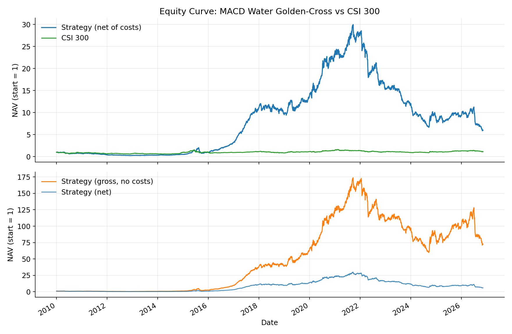
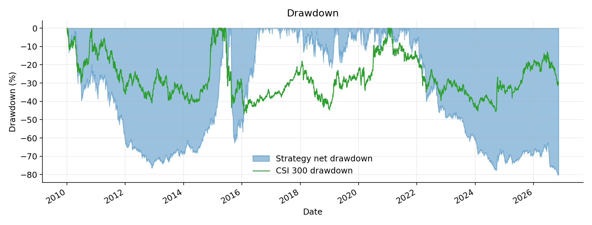
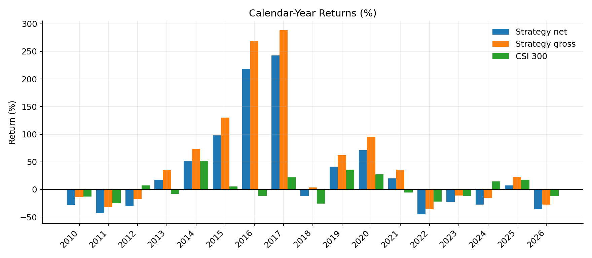
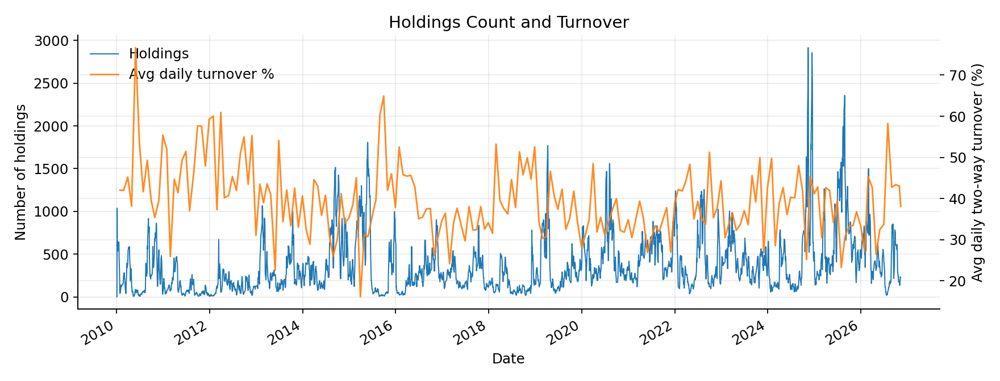

# MACD Water Golden-Cross Backtest (A-shares)

A clean, reproducible backtest of a **MACD “water” golden-cross** long-only strategy on the China A-share universe, benchmarked against CSI 300.

> Portfolio note: this repo shows the research pipeline — rule definition → data → backtest with costs → drawdown diagnosis — not just a return curve.

## Charts

### Equity curve


### Drawdown


### Calendar-year returns


### Holdings & turnover


## Strategy rules

| Item | Rule |
|------|------|
| Entry | DIF crosses above DEA, with DIF > 0 and DEA > 0 |
| Exit | Any death cross (DIF crosses below DEA) |
| Portfolio | Equal-weight all active holdings; cash return = 0 when flat |
| Execution | Signal at close on day T, earn day T+1 return (1-day lag) |
| MACD | EMA 12 / 26 / 9 on raw close |
| Universe | All A-shares (incl. historical names), 2010-01-04 → 2026-11-09 |
| Benchmark | CSI 300 (`000300.SH`) |

### Rebalancing（调仓）

Yes — the book is **rebalanced daily to equal weight**.

- Each stock independently: buy on water golden-cross, sell on death cross
- Every day, capital is spread **equally** across all currently held names
- When the holding set changes (new entries / exits), weights are reset → this creates turnover even without a calendar rebalance schedule
- Measured average daily two-way turnover ≈ **39%**

So this is **signal-driven trading + daily equal-weight rebalancing**, not buy-and-hold of fixed lots.

## Transaction costs

| Side | Components | Rate |
|------|------------|------|
| Buy | commission 3 bps + slippage 10 bps | **0.13%** |
| Sell | commission 3 bps + stamp tax 5 bps + slippage 10 bps | **0.18%** |

Costs are charged on **daily equal-weight turnover**.

## Key results (with costs)

| Metric | Strategy (net) | Strategy (gross) | CSI 300 |
|--------|----------------|------------------|---------|
| Total return | **+498%** | +7160% | +13.4% |
| Ann. return | **11.7%** | 30.2% | 0.8% |
| Sharpe | **0.40** | 1.02 | — |
| Max drawdown | **-80.4%** | -65.6% | -46.7% |

Other diagnostics:

- Average holdings ≈ 369; almost always invested (exposure ≈ 99.95%)
- Average daily two-way turnover ≈ 39% → cost drag is severe
- Worst net drawdown: 2021-09 peak → 2026-10 trough (still unrecovered in-sample)

**Takeaway:** without costs the curve looks exceptional; with realistic friction and equal-weight A-share exposure, most compounding is eaten, and drawdowns remain structurally large because the book is nearly always long and exits are lagging.

## Project layout

```text
macd_water_golden/
├── download_data.py      # Tushare daily bars + CSI 300 (resumable cache)
├── backtest.py           # MACD signals, equal-weight book, costs, metrics
├── plot_results.py       # Build charts under docs/figures/
├── analyze_dd.py         # Drawdown episode helper
├── docs/figures/         # Equity / drawdown / yearly / turnover charts
├── output/               # summary / yearly / monthly / daily nav
└── README.md
```

`data/` is gitignored (large). Run the download script locally once.

## Reproduce

```bash
pip install tushare pandas numpy pyarrow matplotlib

# set token
# Windows PowerShell:
$env:TUSHARE_TOKEN="your_token"

python download_data.py
python backtest.py
python plot_results.py
```

Outputs:

- `output/summary.json` — headline metrics
- `output/yearly.csv` — calendar-year returns
- `output/monthly.csv` — month-end NAV sample
- `output/nav.csv` — daily NAV / returns / costs
- `docs/figures/*.png` — charts embedded above

## Disclaimer

For research / education only. Not investment advice. Past backtests do not guarantee future performance.
